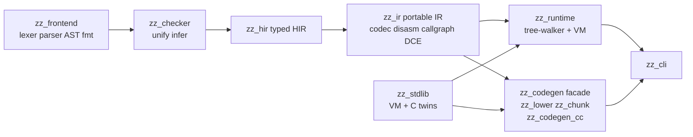
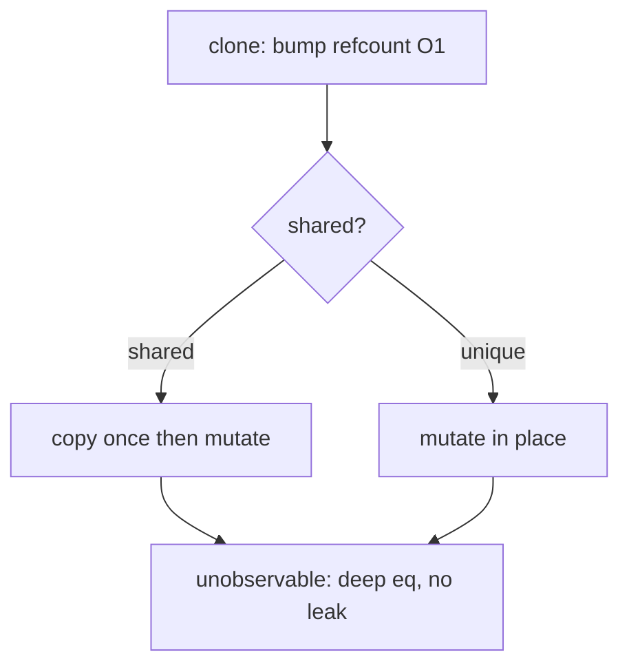
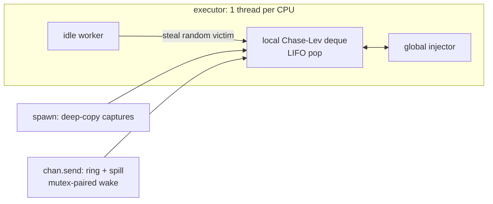

# Compiler architecture

Linear pipeline:

| Crate | Role |
|---|---|
| `zz_frontend` | lexer, parser, AST, lossless formatter, diagnostics (spans, Levenshtein suggestions, fix-its) |
| `zz_checker` | unification type checker with inference |
| `zz_hir` / `zz_ir` | typed HIR, portable IR (codec + disassembler), callgraph + DCE |
| `zz_runtime` | tree-walker interpreter + bytecode VM + C-ABI bridge (`c_abi.rs`) |
| `zz_codegen` | AOT facade + driver: `lower_only`, `build_native*`, `build_chunk_module` |
| `zz_lower` / `zz_chunk` | HIR→C lowering / unified-IR→C lowering |
| `zz_codegen_cc` | Clang/gcc driver, flag matrix, runtime-archive cache, PGO, cross targets |
| `zz_codegen_ffi` | native + staticlib symbol tables, `extern` preludes, link metadata |
| `zz_codegen_runtime` | embedded C runtime (concatenated TU) + content-hash rebuild guard |
| `zz_codegen_types` | `BuildOptions`, `PgoMode`, `EmbedAsset`, `BuildError`, `Clang`, `ClangProvider` |
| `zz_stdlib` | 691 entries (465 `std.*` fns + builtins/aliases/consts) across 42 groups: VM registry + C twins + Rust staticlib (`ffi.rs`), see [reference](../stdlib/reference.md) |
| `zz_cli` (`zz`) | run/build/test/check/fix/fmt, REPL, loader + module cache, doctor, upgrade |
| `zz_lsp` / `zz-dap` | editor server, debug adapter |
| `zz_pm` | registry/git/path deps, publish |
| `zz_paths` | `ZZ_HOME`/cache layout + path containment (dependency-free, shared by CLI and `zz_codegen_cc`) |
| `zz_plugin`, `zz_fmt`, `zz_arena`, `zz_native_rt` | plugin ABI, formatter, arenas, shared native impls |

## Adding a stdlib native — five locksteps

Miss one and CI fails:

1. `zz_stdlib/src/funcs.rs` — checker signature (+ count assertion).
2. `zz_stdlib/src/natives/` — Rust VM impl.
3. `crates/zz_codegen_runtime/src/runtime/*.c` + `.h` — C twin, byte-identical semantics.
4. `crates/zz_codegen_ffi/src/natives.rs` (`native_impl`) — AOT name mapping.
5. Fixture `tests/fixtures/stdlib/<name>_test.zz` + `e2e.rs` + `dual_engine_parity.rs`
   (+ `batch_lists.rs` or `EXCLUDED` with reason).

Contracts for search/byte natives: byte offsets O(1), backend-identical,
matching Rust `str::find` edge semantics.

New compiler work needs `cargo install --path crates/zz_cli` before dogfooding.
Branches off `dev` (`feat/...`, `fix/...`), `cargo fmt` + zero clippy + green tests,
PR to `dev` (never push to `dev`/`main` directly).

Specs: [IR draft](../ir-spec-draft.md), [VM CoW](../design/vm-cow.md).
Checker detail: [Checker](checker.md). Backends: [Runtime and codegen](runtime-codegen.md).
